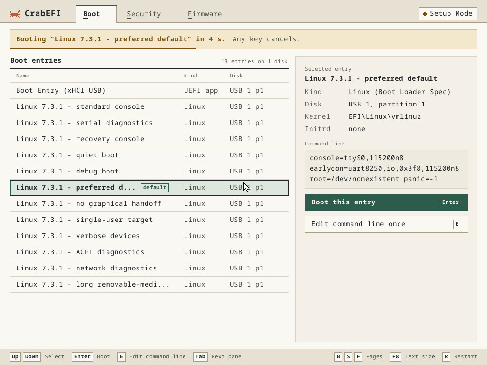

# CrabEFI

A UEFI implementation written in Rust, designed as a reusable library with dependency injection for platform-specific hardware.

CrabEFI implements enough UEFI to boot Linux via shim/GRUB2 or systemd-boot on real hardware. It ships as a coreboot payload, a platform-agnostic boot library, and a separately linked Runtime Services image with bounded scratch allocation.



*Graphical boot menu (`--features ui`) running headlessly in QEMU at
1024×768 with BLS test entries from an EFI System Partition, during the
autoboot countdown. Captured with QEMU `screendump` and converted from PNG to
JPEG using ImageMagick. See [docs/UI.md](docs/UI.md) for the design.*

[Try the UI in your browser](https://arthurheymans.github.io/CrabEFI/) — the same
Rust screens compiled to WebAssembly, with simulated boot devices and settings.

## Documentation

See the [docs/](docs/README.md) directory:

- [Building](docs/BUILDING.md) - How to build CrabEFI and run tests
- [UI Testing](docs/UI_TESTING.md) - Test and screenshot the setup UI without firmware
- [Architecture](docs/ARCHITECTURE.md) - Workspace layout and code organization
- [Integration](docs/INTEGRATION.md) - Using CrabEFI as a library in external firmware
- [Capabilities](docs/capabilities.md) - Minimal/full feature sets, runtime identity and bounded variable storage
- [Memory Management](docs/MEMORY.md) - Memory layout, allocators, and EFI memory map

## Quick Start

```bash
# Enter nix development environment (provides QEMU, mtools, etc.)
nix develop

# Build the coreboot payload
./crabefi build

# Run integration tests
./crabefi test --app hello

# Run interactively in QEMU
./crabefi run --app hello

# Build for aarch64
./crabefi build --arch aarch64
```

## USB and pointing devices

Connect USB boot drives and input devices **before starting CrabEFI**. USB
hotplug/rescanning is not currently supported; restart after attaching a device.
Native 4K logical sectors are supported, including GPT-partitioned USB storage.
Hybrid ISO partitions must start and end on native logical-block boundaries;
unaligned or out-of-device GPT ranges are rejected instead of rounded.

USB configuration descriptors are bounded to 4 KiB, eight active interfaces,
and four endpoints per interface. Alternate setting zero is used; CrabEFI does
not activate other settings. SuperSpeed HID bursts and extended service payloads
are explicitly unsupported rather than configured as single-packet endpoints.

USB input uses HID boot-protocol keyboards and mice. The built-in PS/2 driver
supports standard relative mice and Synaptics touchpads with PS/2 compatibility;
SMBus/I²C-only touchpads and replacement trackpads using other protocols are not
supported. `--features ui` enables the graphical menu, not additional touchpad
protocols. When reporting a non-working replacement trackpad, include its model,
Linux input-device identification, and CrabEFI's PS/2/USB initialization logs.

## Boot device policy

Platforms set `PlatformConfig::boot_policy`; the coreboot payload maps Cargo
features onto it.

`usb-on-demand` (`UsbInit::OnDemand`) leaves USB controllers untouched while
BootNext or BootOrder starts an image from other storage. USB comes up when
BootNext or every BootOrder option failed (they are then retried on USB only),
for the boot menu and the removable-media path `\EFI\BOOT\BOOTX64.EFI`, and for
a pending firmware UI or shim MokManager request. BootOrder options on internal storage therefore
win over USB options, and USB keyboards do not reach GRUB or shim during such a
boot; the serial console does. The boot menu appears when nothing starts
without USB, or after `systemctl reboot --firmware-setup` (OsIndications
`BOOT_TO_FW_UI`); USB keyboards work in it. There is no pre-boot hotkey.

`external-boot-menu-only` (`ExternalBoot::MenuOnly`) keeps USB and removable
media out of BootNext, BootOrder and menu timeouts; the menu lists them after
internal entries and waits for the user when its default entry is external.
`external-boot-deny` (`ExternalBoot::Deny`) never boots them and hides them in
the menu. CrabEFI has no network boot.

The variable `CrabEFIExternalBoot` (GUID `9e80634c-cdc7-41d5-a345-4a297f9c7d1a`,
attributes NV+BS, one byte: 0 allow, 1 menu-only, 2 deny) tightens the build
setting and can never loosen it. Only boot-time code can write it, not the OS.

## Workspace Structure

| Crate | Description |
|-------|-------------|
| `crabefi-core` | Core library -- UEFI implementation and boot-time hardware drivers |
| `crabefi-coreboot` | Coreboot payload binary (arch entry points, table parsing) |
| `crabefi-ui` | Boot menu model, framebuffer, renderer and setup screens, shared by firmware and the UI test harness |
| `crabefi-runtime-abi` | Pointer-free normalized image/handoff ABI |
| `crabefi-runtime-image` | Separate EFI Runtime Services image with image-local bounded scratch allocation |

External firmware implements boot-only platform traits, provides a normalized runtime image plus value-only runtime mechanisms in `PlatformConfig`, and calls `crabefi::init_platform()`. See [docs/INTEGRATION.md](docs/INTEGRATION.md) for details.

## License

Licensed under either of [Apache License, Version 2.0](LICENSE-APACHE) or [MIT License](LICENSE-MIT) at your option.
